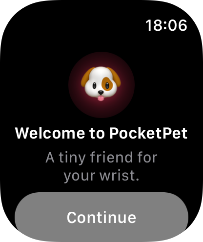
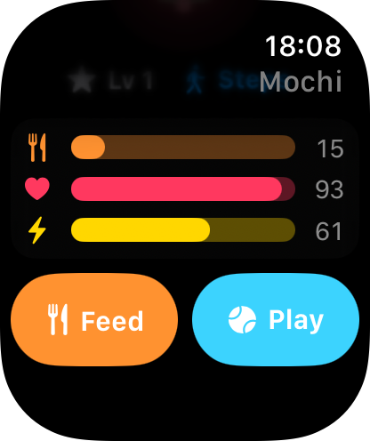
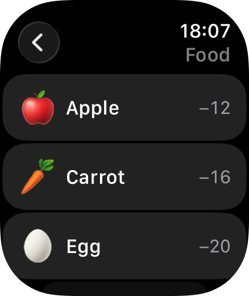
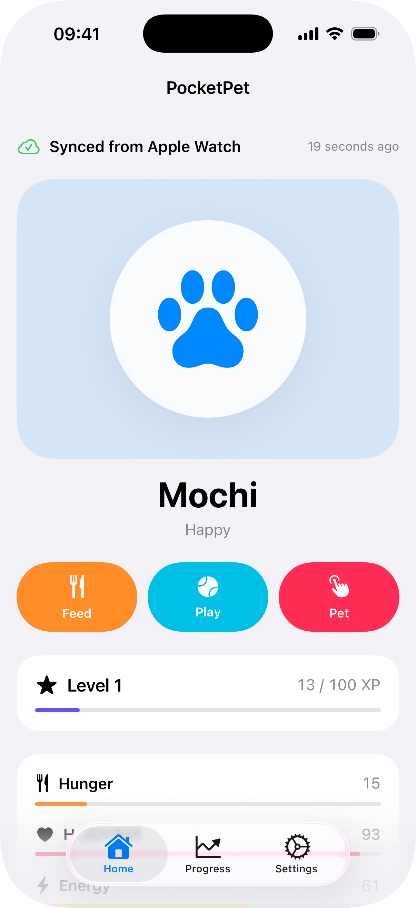
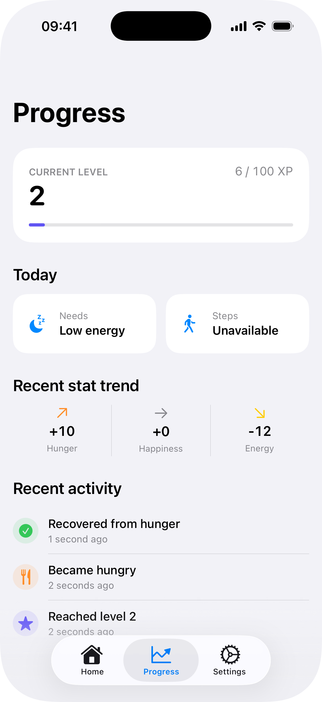

# PocketPet

PocketPet is a virtual pet you adopt and care for on Apple Watch. Give your pet a name, feed it, play with it, and earn XP as you walk. The companion iPhone app shows your pet’s latest status and progress.

Built with Swift and SwiftUI for watchOS and iOS. PocketPet is currently an MVP with placeholder pet artwork.

## Screenshots

| Apple Watch · Meet your pet | Apple Watch · Daily care | Apple Watch · Choose food |
| :---: | :---: | :---: |
|  |  |  |
| Start the guided setup and choose a name. | Check your pet’s needs and play with it. | Choose a snack to reduce hunger. |

| iPhone · Home | iPhone · Progress |
| :---: | :---: |
|  |  |
| See your pet’s latest state and send care actions to the watch when it’s reachable. | Follow level-ups, changes in needs, and other recent activity. |

Captured on paired Apple Watch Series 11 and iPhone 17 Pro simulators with an example pet named Mochi.

## How it works

- **Care for your pet.** Hunger, happiness, and energy change over time. Feed your pet when it gets hungry, play to make it happier, or tap it on the watch to pet it.
- **Earn XP.** Care actions award XP. With optional HealthKit permission, every 1,000 daily steps adds 2 XP. Your pet levels up every 100 XP.
- **Check in from iPhone.** The watch owns the pet’s state and sends updates via WatchConnectivity. The iPhone keeps the last received snapshot so you can still see your pet’s status when the watch is out of reach.
- **Keep your pet in view.** An iPhone Home Screen widget and an Apple Watch complication show your pet’s latest available status at a glance.

## Run locally

**Requirements** · Xcode 26.2 or later, iOS 26.2+, and watchOS 26.2+.

```sh
git clone https://github.com/ugurmetinkarabulut/PocketPet.git
cd PocketPet
open PocketPet.xcodeproj
```

1. Run the **PocketPet Watch App** scheme on an Apple Watch simulator and finish onboarding.
2. Run the **PocketPet** scheme on its paired iPhone simulator to try the companion app.
3. For physical devices, select your Apple Developer team and configure the target bundle identifiers and the watch app’s companion bundle identifier. Use the same App Group identifier in the app and extension entitlements and in the Swift code that reads and writes shared data. Enable HealthKit for the watch app to try step rewards.

## Project structure

| Target or folder | Responsibility |
| --- | --- |
| `PocketPet Watch App` | Onboarding, pet state, care actions, HealthKit step rewards, and local notifications |
| `PocketPet` | Companion app, WatchConnectivity commands, cached snapshots, and progress history |
| `PocketPet Shared` | Shared snapshot and command models and widget storage |
| `PocketPet Widget` and `PocketPet Complication` | WidgetKit views for iPhone and Apple Watch |

The project uses Apple frameworks, stores data on the devices, and syncs directly between the watch and phone.
